# i2vAuthAPI — Complete API Guide with Working Diagrams

> **Base URL:** `http://localhost:8080`
> **Auth:** JWT Bearer (`Authorization: Bearer <token>`)
> **Framework:** Spring Boot 3.1.2 · Java 17 · SQL Server · Flyway · Maven
> **Time zone:** `Asia/Kolkata` (set in `I2vAuthApiApplication.main`, enforced in attendance logic)
> **Related docs:** `API_DOCUMENTATION.md` (quick reference) · `CODE_AUDIT_REPORT.md` · `SECURITY_FIXES_APPLIED.md`

---

## Table of Contents

1. [System Overview & Architecture](#1-system-overview--architecture)
2. [Request Pipeline & Security Layers](#2-request-pipeline--security-layers)
3. [Authentication Module](#3-authentication-module)
4. [RBAC / Module Access (Permission Engine)](#4-rbac--module-access-permission-engine)
5. [Users & Employees](#5-users--employees)
6. [Departments, Designations & Hierarchy](#6-departments-designations--hierarchy)
7. [Attendance](#7-attendance)
8. [Admin Attendance](#8-admin-attendance)
9. [Leaves](#9-leaves)
10. [Exit Management](#10-exit-management)
11. [Files (Azure Blob)](#11-files-azure-blob)
12. [Settings & Company Settings](#12-settings--company-settings)
13. [Database Model (ER Diagram)](#13-database-model-er-diagram)
14. [Caching, Async & Scheduled Behavior](#14-caching-async--scheduled-behavior)
15. [Error Handling](#15-error-handling)
16. [Email Templates](#16-email-templates)
17. [Known Limitations & Security Notes](#17-known-limitations--security-notes)
18. [Holidays](#18-holidays)

---

## 1. System Overview & Architecture

```mermaid
flowchart LR
    subgraph Client
        A[React SPA<br/>i2v-auth-ui]
    end
    subgraph "i2vAuthAPI (Spring Boot)"
        RF[RateLimitingFilter]
        JF[JwtAuthenticationFilter]
        SC[SecurityConfig<br/>stateless + CORS]
        CTRL[Controllers]
        SVC[Services]
        PERM[PermissionService<br/>+ ModuleRouteConfig<br/>+ SecurityUtils]
        REPO[Repositories]
        EMAIL[EmailService<br/>@Async Thymeleaf]
        AUDIT[AuditService<br/>@Async]
    end
    subgraph "Infrastructure"
        DB[(SQL Server<br/>Flyway migrations)]
        AZ[Azure Blob Storage<br/>container: i2v-uploads]
        SMTP[Gmail SMTP]
    end

    A -->|"HTTPS + JWT"| RF
    RF --> JF
    JF --> SC
    SC --> CTRL
    CTRL --> SVC
    SVC --> PERM
    SVC --> REPO
    SVC --> EMAIL
    SVC --> AUDIT
    REPO --> DB
    SVC --> AZ
    EMAIL --> SMTP
```

**Layered view of the codebase** (`src/main/java/com/world/i2v/i2vauthapi`):

| Layer | Package | Examples |
|---|---|---|
| Entry | `I2vAuthApiApplication.java` | `@SpringBootApplication`, `@EnableJpaAuditing`, `@EnableCaching`, `@EnableAsync`, `@EnableScheduling`, TZ forced to `Asia/Kolkata` |
| Web | `Controller` | 19 controllers under `/api/**` |
| Security | `security` | `SecurityConfig`, `JwtUtil`, `JwtAuthenticationFilter`, `RateLimitingFilter`, `SecurityUtils`, `CustomUserDetailsService`, `UserDetailsImpl` |
| Business | `service` | 28 services (auth, attendance, leave, exit, permissions, hierarchy…) |
| Persistence | `repository` | Spring Data JPA repositories |
| Model | `entity` / `dto` | 26 entities, request/response DTOs |
| Config | `Config` | `ModuleRouteConfig` (in-memory route registry), `WebConfig` (CORS), `JpaConfig`, `AuditConfig` |
| Errors | `exception` | `GlobalExceptionHandler`, 3 business exceptions |
| Schema | `resources/db/migration` | Flyway: `V1`, `V7`, `V8`, `V9`, `V10` |

---

## 2. Request Pipeline & Security Layers

### 2.1 Filter chain order

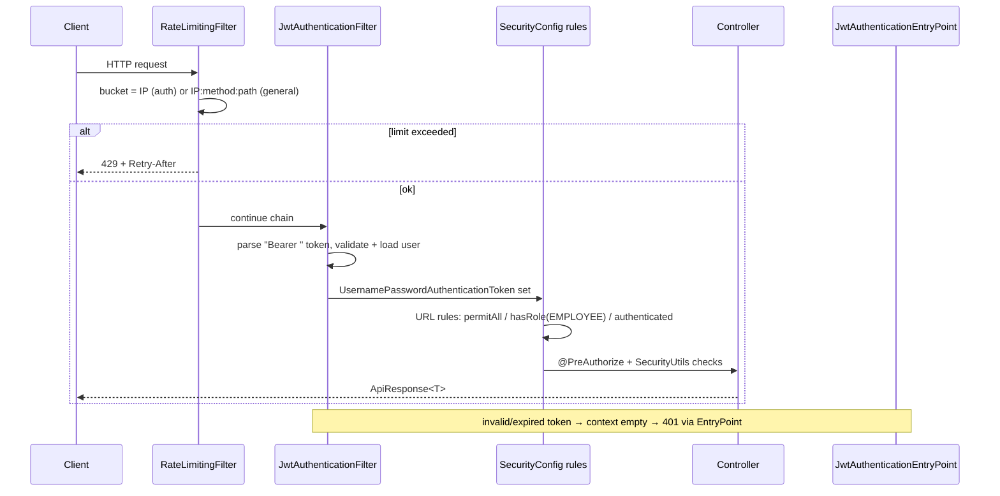

Exact order configured in `SecurityConfig.java:91-92`:
`RateLimitingFilter` → `JwtAuthenticationFilter` → `UsernamePasswordAuthenticationFilter`.

### 2.2 URL-level security matrix (`SecurityConfig.java:57-88`)

| Pattern | Rule |
|---|---|
| `/api/auth/**`, `/api/public/**`, `/error` | `permitAll` |
| `/`, `/index.html`, `/static/**`, `/public/**`, `/favicon.ico` | `permitAll` |
| `/api/leaves/**` | `hasRole("EMPLOYEE")` |
| `/api/admin/attendance/**` | `hasRole("EMPLOYEE")` |
| `/api/employees/**` | `hasRole("EMPLOYEE")` |
| `/api/module-access/**` | `hasRole("EMPLOYEE")` |
| `/api/departments/**` | `hasRole("EMPLOYEE")` |
| `/api/designations/**` | `hasRole("EMPLOYEE")` |
| `/api/modules/**` | `hasRole("EMPLOYEE")` |
| `/api/attendance/**` | `authenticated()` (any role) |
| `/api/**` | `authenticated()` (catch-all) |
| any other | `authenticated()` |

Finer control is method-level via `@PreAuthorize` + the `@securityUtils` bean (see Section 4).

### 2.3 Rate limiting (`RateLimitingFilter.java`)

| Group | Key | Limit | Window | Exceed response |
|---|---|---|---|---|
| Auth (`/api/auth/login`, `/signup`, `/forgot-password`) | client IP | 5 (configurable `security.rate-limit.auth.requests`) | 60 s | 429 `{"error":"Too many authentication attempts...","retryAfter":60}` + `Retry-After` |
| General (all other `/api/**`) | `IP:method:path` | 300 (configurable) | 60 s | 429 `{"error":"Too many requests..."}` |

- Implementation: **fixed-window counter** in two `ConcurrentHashMap`s (in-memory, per instance — not distributed).
- Excluded: `OPTIONS`, non-`/api` paths, `/health`, `/actuator/health`, `/public/**`, `/api/public/**`.
- IP resolution order: `X-Forwarded-For` → `Proxy-Client-IP` → `WL-Proxy-Client-IP` → `getRemoteAddr()`.

### 2.4 JWT details (`JwtUtil.java`)

| Item | Value |
|---|---|
| Algorithm | HS512 |
| Secret | `jwt.secret` (env `JWT_SECRET`) |
| Access token claims | `sub`=email, `role`, `type`="access", `iat`, `exp` = now + `jwt.expiration` (**default 7 days**) |
| Refresh token claims | `sub`=email, `type`="refresh", `iat`, `exp` = now + `jwt.refresh-expiration` (**default 24 h**) |
| Validation | signature, malformed, expiry, unsupported, illegal-arg → `validateToken` false |

### 2.5 CORS

- Origins from `cors.allowed-origins` (defaults: `localhost:3000/3001/5173/4000` + Azure UAT URL; `*` filtered out; falls back to `localhost:3000`).
- Methods: GET, POST, PUT, PATCH, DELETE, OPTIONS. Headers `*`. `Authorization` exposed. `allowCredentials(true)`, `maxAge=3600`.
- Registered twice: `SecurityConfig.corsConfigurationSource` and `WebConfig.addCorsMappings` (`/api/**`).

---

## 3. Authentication Module

Base path: **`/api/auth`** — all endpoints `permitAll` at URL level except the three session endpoints which use `@PreAuthorize("hasRole('EMPLOYEE')")`.

| # | Endpoint | Body / Params | Auth | Response |
|---|---|---|---|---|
| 1 | `POST /api/auth/signup` | `SignupRequest` | Public | 201 `ApiResponse<Void>` "User registered successfully" |
| 2 | `POST /api/auth/login` | `LoginRequest` + IP/User-Agent | Public | 200 `ApiResponse<JwtResponse>` |
| 3 | `POST /api/auth/logout` | `Authorization` header | Public | 200 `ApiResponse<Void>` |
| 4 | `POST /api/auth/refresh-token` | `RefreshTokenRequest` | Public | 200 `ApiResponse<JwtResponse>` |
| 5 | `POST /api/auth/forgot-password` | `ForgotPasswordRequest` | Public | 200 "Password reset link sent to your email" |
| 6 | `POST /api/auth/reset-password` | `ResetPasswordRequest` | Public | 200 "Password reset successfully" |
| 7 | `GET /api/auth/sessions` | — | EMPLOYEE | `ApiResponse<List<Map>>` (id, deviceInfo, ipAddress, location, loginAt, lastActivityAt, isCurrentSession) |
| 8 | `DELETE /api/auth/sessions/{sessionId}` | optional `X-Current-Token` | EMPLOYEE | `ApiResponse<Void>` (400 if current session) |
| 9 | `POST /api/auth/sessions/revoke-all` | optional `X-Current-Token` | EMPLOYEE | `ApiResponse<Map>` {revokedCount} |

**Request DTO validation:**
- `LoginRequest`: `email` `@NotBlank @Email`, `password` `@NotBlank`.
- `SignupRequest`: `fullName` `@NotBlank @Size(2-100)`, `email` `@NotBlank @Email`, `password` `@NotBlank @Size(6-40)`, `confirmPassword` `@NotBlank`, `role` optional default `GENERAL`.
- `ResetPasswordRequest`: `token` `@NotBlank`, `newPassword` `@NotBlank @Size(6-40)`, `confirmPassword` `@NotBlank`.

**JwtResponse shape:** `{ accessToken, refreshToken, tokenType:"Bearer", userId, email, fullName, role }`.

### 3.1 Signup flow

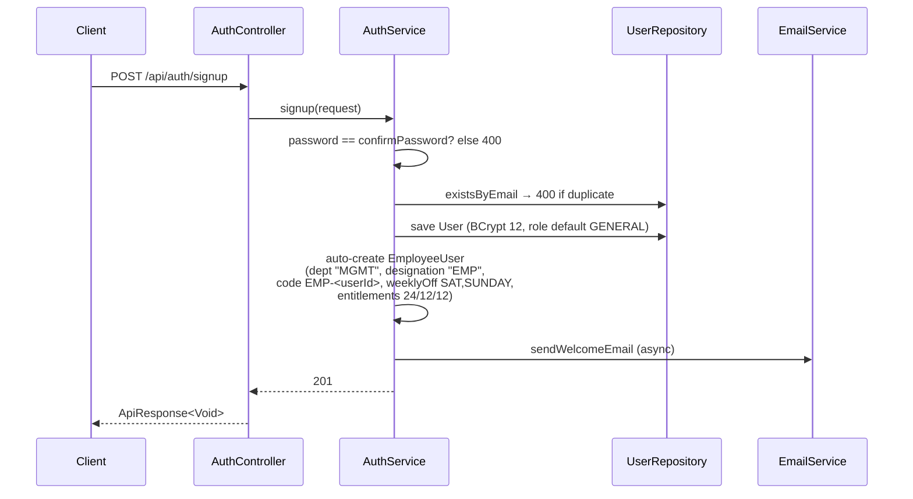

### 3.2 Login flow

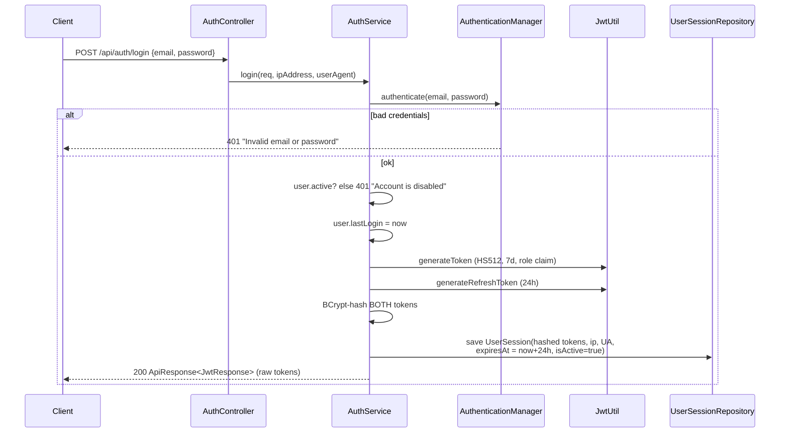

### 3.3 JWT authentication on subsequent requests

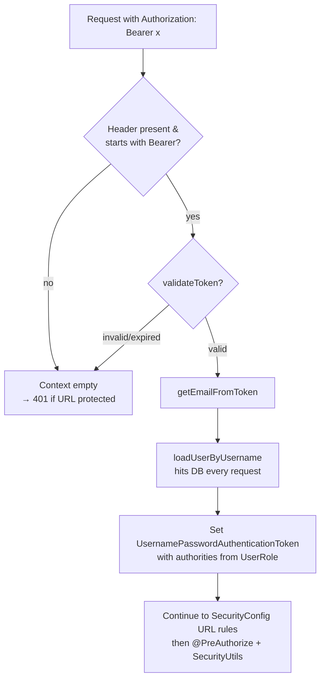

### 3.4 Refresh token rotation

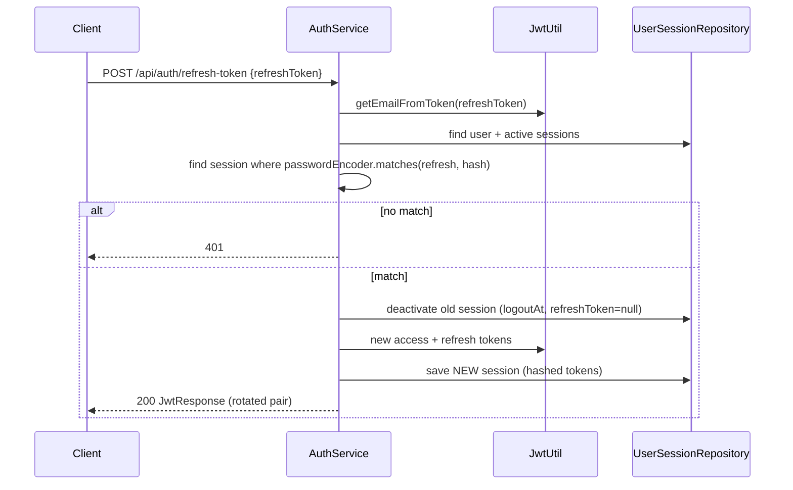

### 3.5 Logout

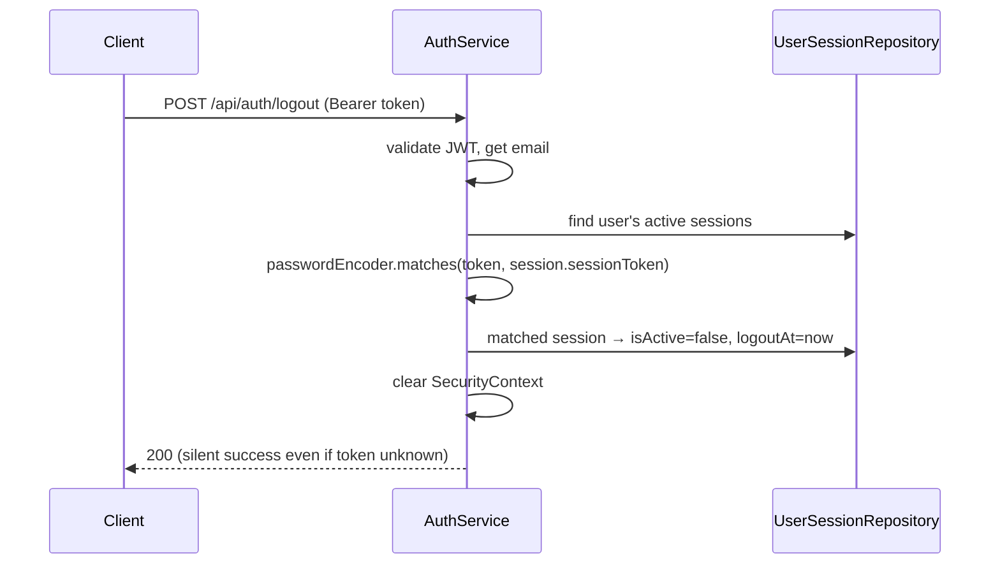

### 3.6 Forgot / Reset password

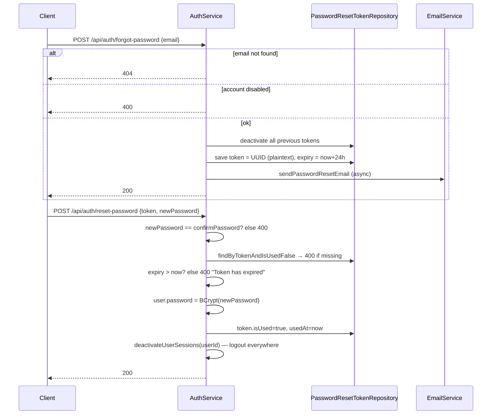

**Session model** (`user_sessions`): both tokens stored **BCrypt-hashed**; `expiresAt = login + 24 h` (hardcoded); revocation performed by iterating sessions and `matches()` on the hash.

---

## 4. RBAC / Module Access (Permission Engine)

This is the heart of the system: **Department/Designation-based module access control**.

### 4.1 Data model

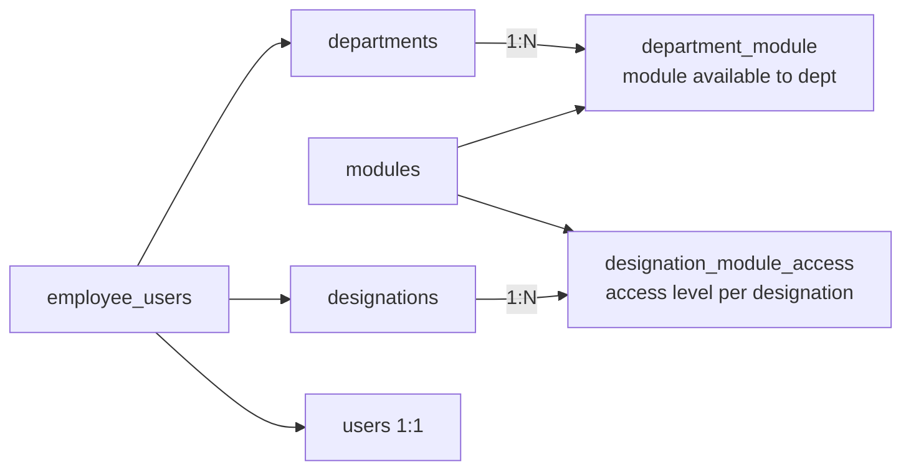

Two junctions must exist for a module to be usable by an employee:

| Mapping | Table | Meaning |
|---|---|---|
| Department ↔ Module | `department_module` | module is enabled for the department |
| Designation ↔ Module | `designation_module_access` | what the designation may do (`NONE`, `READ`, `WRITE`, `ADMIN`) |

`AccessLevel` enum: `NONE, READ, WRITE, ADMIN` (entity `AccessLevel.java`).

### 4.2 Permission resolution algorithm (`PermissionService.getUserPermissions`)

```mermaid
flowchart TD
    A[getUserPermissions userId] --> B{user exists?}
    B -- no --> Z1[empty map]
    B -- yes --> C{employee profile?}
    C -- no --> Z2[isEmployee=false]
    C -- yes --> D{department AND designation?}
    D -- no --> Z3[partial info]
    D -- yes --> E[Load active department_module rows]
    E --> F[Load active designation_module_access rows]
    F --> G[accessMap by moduleId]
    G --> H["Pass 1: for each active dept module<br/>→ build perms from accessMap (default NONE)"]
    H --> I["Pass 2 (REPAIR): for each active designation access<br/>with NO department_module row at all<br/>→ include module anyway"]
    I --> J["Skip modules whose dept row exists but inactive<br/>(deliberately removed)"]
    J --> K[Emit maps:
    modules = {MODULE_CODE: perms},
    modulesByRoute = {/route: perms},
    moduleList]
```

**Permission object per module:** `moduleId, moduleName, moduleCode, routePath, description, icon, displayOrder, isVisible, isActive, read, create, update, delete, approve, export, import, accessLevel (bool), accessLevelName (NONE/READ/WRITE/ADMIN)`.

- Code keys are normalized to uppercase; route paths normalized to lowercase with leading `/` and no trailing `/`.
- Result is cached: `@Cacheable(value="userPermissions", key="#userId")` (TTL 15 min via `spring.cache.caffeine.spec`, plus eviction on mutations).

### 4.3 Authorization checks (`SecurityUtils`)

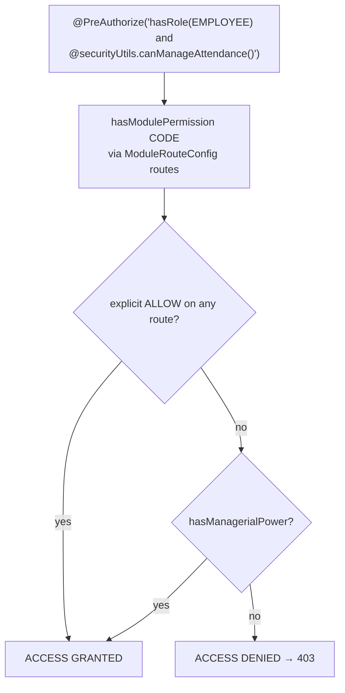

- `checkPermissionWithStrictFallback`: explicit route allow first; then **managerial power fallback** — `designation.isManagerial == true` OR current user is `department.manager` (SecurityUtils.java:150-179, 282-302).
- Access level matrix: `read` → canRead or WRITE/ADMIN; `write/create/update` → canCreate/canUpdate or WRITE/ADMIN; `delete`/`approve` → flag or ADMIN; `admin` → ADMIN only.

**Attendance convenience checks** (important — this is what gated the reported bug):

| Check | Modules checked | Fallback |
|---|---|---|
| `canReadAttendance()` | `ATTENDANCE` / `ATTENDANCE_MANAGEMENT` read, or group `attendance` | **Any employee passes** (SecurityUtils.java:117-125) |
| `canManageAttendance()` | `ATTENDANCE` / `ATTENDANCE_MANAGEMENT` write | **None — strict 403** (SecurityUtils.java:128-132) |

### 4.4 Module route registry (`ModuleRouteConfig`)

- Loaded at startup (`@PostConstruct`) from **active** modules in DB; keyed by code (upper/lower), normalized name, and module id; groups routes by first path segment (e.g. `/attendance` → group `attendance`).
- `refreshRoutes()` re-loads on module create/update/delete (added with the 2026-09-30 fix) and is exposed as `POST /api/modules/refresh-routes`.

### 4.5 Granting access (with the 2026-09-30 repair fix)

```mermaid
sequenceDiagram
    participant A as Admin (Module Access UI)
    participant M as ModuleAccessService
    participant R as DesignationModuleAccessRepository
    participant D as DepartmentModuleRepository
    participant P as PermissionService (cache)

    A->>M: POST /module-access/designation<br/>{designationId, moduleId, accessLevel}
    M->>R: upsert DesignationModuleAccess<br/>(READ→canRead, WRITE→canCreate+update,<br/>ADMIN→+delete+approve; isActive=true)
    alt accessLevel != NONE and designation has department
        M->>D: department_module exists?
        alt missing
            M->>D: CREATE active department_module row
        else inactive
            M->>D: REACTIVATE row
        end
    end
    M->>P: @CacheEvict(userPermissions, allEntries)
    M-->>A: 200 ApiResponse<Void>
```

- `POST /api/module-access/department/{deptId}` takes `List<Long>` moduleIds and **replaces** the department's active module set (deactivates the rest).
- Module create/update/delete also evicts the `userPermissions` cache and calls `ModuleRouteConfig.refreshRoutes()` — newly created/activated modules work without restart.

### 4.6 Module Access endpoints

| # | Endpoint | Auth | Request | Response |
|---|---|---|---|---|
| 1 | `GET /api/module-access/bootstrap` | EMPLOYEE | — | `ApiResponse<Map>` {departments, designations, modules} |
| 2 | `GET /api/module-access/my-permissions` | EMPLOYEE | — | `ApiResponse<Map>` full permission map (Section 4.2) |
| 3 | `GET /api/module-access/department/{deptId}` | EMPLOYEE | — | `ApiResponse<List<ModuleResponse>>` |
| 4 | `GET /api/module-access/designation/{desigId}` | EMPLOYEE | — | `ApiResponse<List<DesignationModuleAccessResponse>>` |
| 5 | `POST /api/module-access/department/{deptId}` | + `canManageModuleAccess` | `List<Long>` | `ApiResponse<Void>` |
| 6 | `POST /api/module-access/designation` | + `canManageModuleAccess` | `DesignationModuleAccessRequest` | `ApiResponse<Void>` (auto-assigns dept module) |
| 7 | `DELETE /api/module-access/department/{deptId}/module/{modId}` | + `canManageModuleAccess` | — | `ApiResponse<Void>` (deactivates row) |
| 8 | `DELETE /api/module-access/designation/{desigId}/module/{modId}` | + `canManageModuleAccess` | — | `ApiResponse<Void>` (deactivates access) |

`canManageModuleAccess()` = module permission `MODULE_ACCESS`/`PERMISSIONS` (admin) or group `module-access` (admin).

### 4.7 Modules endpoints

`GET /api/modules`, `GET /api/modules/active`, `GET /api/modules/{id}`, `POST /api/modules`, `PUT /api/modules/{id}`, `DELETE /api/modules/{id}` (soft delete, `isActive=false`), `POST /api/modules/refresh-routes`, `GET /api/modules/active-routes`. Module fields: `name`, `code` (unique), `description`, `icon`, `routePath`, `displayOrder`, `isActive`, `isVisible`, `requiresPremium`, `parentModuleId`.

---

## 5. Users & Employees

### 5.1 Users (`/api/users`)

| # | Endpoint | Auth | Behavior |
|---|---|---|---|
| 1 | `GET /api/users` | EMPLOYEE | all users → `List<UserResponse>` |
| 2 | `GET /api/users/{id}` | EMPLOYEE | one user |
| 3 | `GET /api/users/me` | EMPLOYEE | current user |
| 4 | `PUT /api/users/{id}/status?active=` | + `canManageUsers` | flips `User.active` only (no sessions/email/audit) |

`User` fields: `fullName`, `email` (unique), `password`, `active`, `role` (`GENERAL|CUSTOMER|VENDOR|EMPLOYEE`), `emailVerified`, `lastLogin`, `createdBy/updatedBy`, 1:1 `employee`.

### 5.2 Employees (`/api/employees`)

| # | Endpoint | Auth | Behavior |
|---|---|---|---|
| 1 | `GET /api/employees` | EMPLOYEE | all employees |
| 2 | `GET /api/employees/{id}` | EMPLOYEE | by id |
| 3 | `GET /api/employees/code/{code}` | EMPLOYEE | by employee code |
| 4 | `GET /api/employees/department/{deptId}` | EMPLOYEE | by department |
| 5 | `GET /api/employees/designation/{desigId}` | EMPLOYEE | by designation |
| 6 | `GET /api/employees/me` | EMPLOYEE | current employee (loads all + in-memory filter) |
| 7 | `GET /api/employees/{id}/user-active` | EMPLOYEE | `ApiResponse<Boolean>` |
| 8 | `GET /api/employees/{id}/leave-balance?year=` | EMPLOYEE | `{annual, sick, casual: {used,total,remaining}}` |
| 9 | `POST /api/employees` | + `canManageEmployees` | create (201) |
| 10 | `POST /api/employees/join` | EMPLOYEE | attach employee to pre-existing user (201) |
| 11 | `PUT /api/employees/{id}` | + `canManageEmployees` | update |
| 12 | `DELETE /api/employees/{id}` | EMPLOYEE only | full cascade delete (attendance, leaves, exit requests) |
| 13 | `PATCH /api/employees/{id}/profile` | EMPLOYEE | self-profile: only non-null contact/address/emergency fields |
| 14 | `POST /api/employees/{id}/deactivate-user?reason=` | + `canManageEmployees` | `User.active=false`, kill sessions, email |
| 15 | `POST /api/employees/{id}/reactivate-user?reason=` | + `canManageEmployees` | `User.active=true`, email |
| 16 | `POST /api/employees/user/{userId}/deactivate?reason=` | EMPLOYEE | same for user without employee record |
| 17 | `POST /api/employees/user/{userId}/reactivate?reason=` | EMPLOYEE | mirror |
| 18 | `PUT /api/employees/{id}/leave-entitlements` | + `canManageEmployees` | `{annualLeavesEntitled, sickLeavesEntitled, casualLeavesEntitled}` |
| 19 | `POST /api/employees/bulk-leave-entitlements` | + `canManageEmployees` | `{departmentId, leaveType, entitledDays}` |

### 5.3 Employee lifecycle

```mermaid
flowchart TD
    SIGNUP[User signs up<br/>auto EmployeeUser created] --> JOIN[POST /employees/join<br/>attach real profile to existing user]
    CREATE[POST /employees<br/>admin creates full profile] --> ACTIVE[ACTIVE]
    JOIN --> ACTIVE
    ACTIVE --> UPDATE[PUT /employees/{id}<br/>any field + loginEmail + status]
    UPDATE -->|employmentStatus changes| EMAIL[Status-change email]
    ACTIVE --> DEACT[POST /employees/{id}/deactivate-user]
    DEACT -->|User.active=false + sessions killed| INACTIVE[INACTIVE]
    INACTIVE --> REACT[POST /employees/{id}/reactivate-user]
    REACT --> ACTIVE
    ACTIVE --> DEL[DELETE /employees/{id}]
    DEL --> CASCADE[Delete attendance + leaves + exit requests,<br/>detach user.employee, delete employee, keep User]
```

**Create/update business rules** (`EmployeeUserService`):
- `employeeCode` unique (create; update only if changed). One employee per user (shared PK via `@MapsId`).
- Any employee-attached user forced to `UserRole.EMPLOYEE`.
- `loginEmail` change validated against `users.email` uniqueness.
- Required: `departmentId`, `designationId`, `joiningDate`. Defaults: `employmentType=PERMANENT`, `employmentStatus=ACTIVE`, country `India`.
- `EmployeeUser` hierarchy links: `reportingTo` (self-FK), `unitId`, `squadId`, `territoryId`, `fotId` (nullable).
- KYC fields stored in `kycData` (JSON string) + document URLs.

---

## 6. Departments, Designations & Hierarchy

### 6.1 Departments (`/api/departments`)

| # | Endpoint | Auth | Behavior |
|---|---|---|---|
| 1 | `GET /api/departments` | EMPLOYEE | all |
| 2 | `GET /api/departments/active` | EMPLOYEE | active only |
| 3 | `GET /api/departments/{id}` | EMPLOYEE | one |
| 4 | `POST /api/departments` | + `canManageDepartments` | create (name/code unique, auto-code from name) |
| 5 | `PUT /api/departments/{id}` | + `canManageDepartments` | update (self-parent blocked; no deep cycle detection) |
| 6 | `DELETE /api/departments/{id}` | + `canManageDepartments` | **soft delete** (`isActive=false`) |

Fields: `name` (unique), `code` (unique), `description`, `parentDepartmentId`, `unitId`, `isHierarchyUnit`, `managerId` (**User** FK), `isActive`, `budget`, `location`, `email`, `phone`.

### 6.2 Designations (`/api/designations`)

| # | Endpoint | Auth | Behavior |
|---|---|---|---|
| 1 | `GET /api/designations` | EMPLOYEE | all |
| 2 | `GET /api/designations/{id}` | EMPLOYEE | one |
| 3 | `GET /api/designations/department/{deptId}` | EMPLOYEE | by department |
| 4 | `POST /api/designations` | + `canManageDesignations` | create (title unique) |
| 5 | `PUT /api/designations/{id}` | + `canManageDesignations` | update |
| 6 | `DELETE /api/designations/{id}` | + `canManageDesignations` | **soft delete** |

Fields: `title` (unique), `code`, `description`, `level` (1–5), `departmentId`, `minSalary/maxSalary`, `isActive`, `isManagerial`.
`isManagerial=true` unlocks the managerial-power authorization bypass (Section 4.3).

### 6.3 Hierarchy (`/api/hierarchy`) — Unit → Squad → Territory → FOT

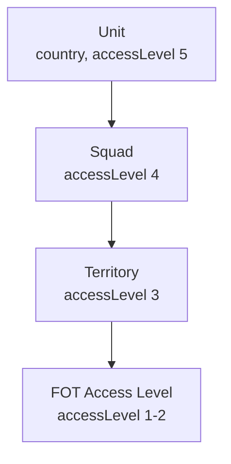

| Endpoint | Auth | Notes |
|---|---|---|
| `GET /api/hierarchy/full` | EMPLOYEE | nested tree |
| `GET /api/hierarchy/units`, `/units/{id}` | EMPLOYEE | |
| `POST/PUT/DELETE /api/hierarchy/units...` | + `canManageDepartments` | delete guarded: unit must have no squads |
| `GET /api/hierarchy/squads`, `/squads/by-unit/{unitId}` | EMPLOYEE | |
| `POST/PUT/DELETE /api/hierarchy/squads...` | + `canManageDepartments` | name unique per unit; delete guarded: no territories |
| `GET /api/hierarchy/territories`, `/territories/by-squad/{squadId}` | EMPLOYEE | |
| `POST/PUT/DELETE /api/hierarchy/territories...` | + `canManageDepartments` | name unique per squad; delete guarded: no FOTs |
| `GET /api/hierarchy/fot-access-levels`, `/fot-access-levels/by-territory/{territoryId}` | EMPLOYEE | |
| `POST/PUT/DELETE /api/hierarchy/fot-access-levels...` | + `canManageDepartments` | hard delete, no guard |

Access level semantics: 1 = Field Officer, 2 = Supervisor, 3 = Operational Manager, 4 = Project Head, 5 = Unit Head/Corporate.

---

## 7. Attendance

Base path: **`/api/attendance`** (self-service).

| # | Endpoint | Params | Auth | Response |
|---|---|---|---|---|
| 1 | `POST /check-in` | `location?`, `ipAddress?` | `isAuthenticated()` | `ApiResponse<Map>` {id, checkInTime, attendanceDate, isLate, lateMinutes} |
| 2 | `POST /check-out` | `location?`, `ipAddress?` | `isAuthenticated()` | {id, checkInTime, checkOutTime, totalHours, attendanceDate} |
| 3 | `GET /today` | — | + `canReadAttendance` | today's record or null |
| 4 | `GET /history?startDate&endDate` | optional ISO dates (default: month-to-date), `Pageable` | + `canReadAttendance` | `ApiResponse<Page<Map>>` |
| 5 | `GET /summary` (alias `/summery`) | `year?`, `month?` | + `canReadAttendance` | `ApiResponse<Map>` summary |

### 7.1 Check-in flow

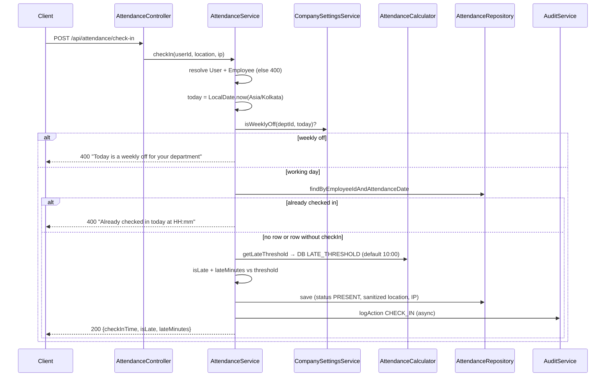

Notes:
- Location strings containing "permission denied"/"not available"/"denied" are nulled (`sanitizeLocation`).
- Holidays are **not** blocked at check-in (only weekly off).
- DB unique constraint `(employee_id, attendance_date)` is the second line of defense.

### 7.2 Check-out flow

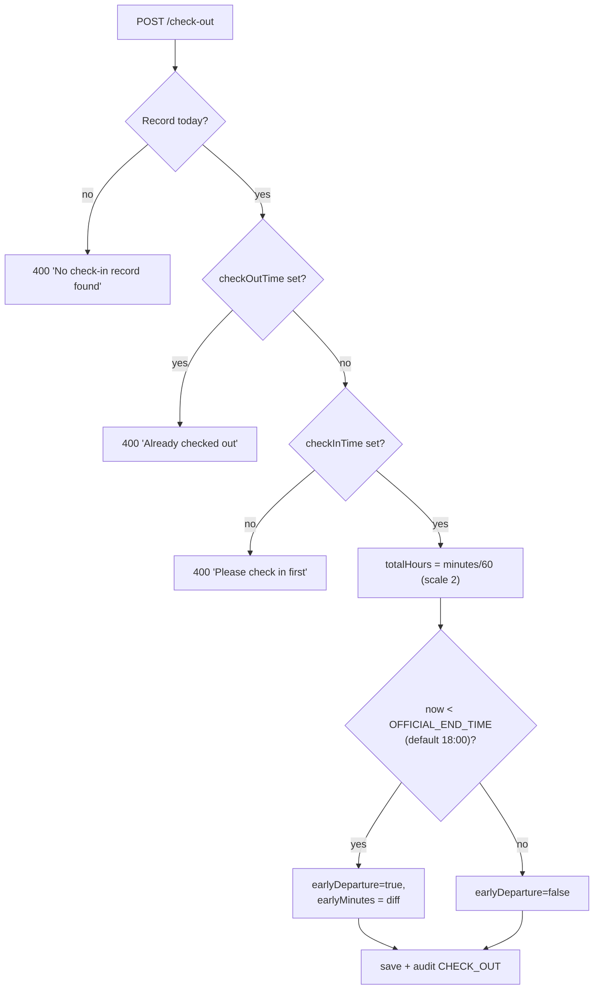

### 7.3 Summary calculation

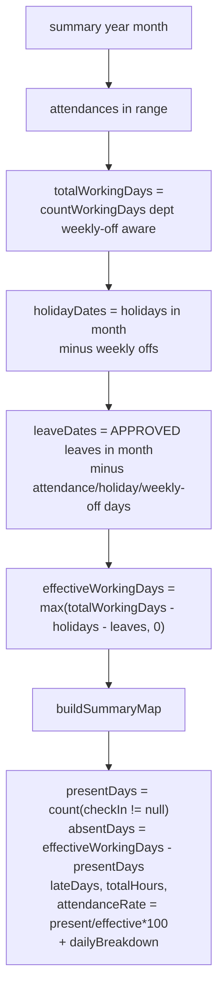

`AttendanceCalculator` formulas and defaults:

| Value | Formula | Default |
|---|---|---|
| Late threshold | DB `LATE_THRESHOLD` | `10:00` |
| Official start/end | DB `OFFICIAL_START_TIME` / `OFFICIAL_END_TIME` | `09:00` / `18:00` |
| Working hours/day | DB `WORKING_HOURS_PER_DAY` | `9` |
| Working days (no dept) | Mon–Fri only | — |
| Present | any row with `checkInTime != null` | — |
| Late | `isLate == true` | — |
| Attendance rate | `present / workingDays * 100` (2dp) | — |

---

## 8. Admin Attendance

Base path: **`/api/admin/attendance`** — every endpoint requires `hasRole('EMPLOYEE') and @securityUtils.canManageAttendance()` (strict — no fallback; `WRITE`/`ADMIN` on `ATTENDANCE`/`ATTENDANCE_MANAGEMENT`).

| # | Endpoint | Params | Response |
|---|---|---|---|
| 1 | `GET /employees?year&month` | required, `Pageable` | `ApiResponse<Page<Map>>` (presentDays, lateDays, totalHours, attendancePercentage) |
| 2 | `GET /employee/{id}?startDate&endDate` | required, `Pageable` | `ApiResponse<Page<AttendanceResponse>>` |
| 3 | `GET /employee/{id}/summary?year&month` | required | `ApiResponse<AttendanceSummaryResponse>` |
| 4 | `GET /employee/{id}/today` | — | `ApiResponse<AttendanceResponse>` |
| 5 | `POST /mark` | `@Valid AttendanceRequest` | 201 `ApiResponse<AttendanceResponse>` |
| 6 | `PUT /{attendanceId}` | `@Valid AttendanceRequest` | `ApiResponse<AttendanceResponse>` |
| 7 | `DELETE /{attendanceId}` | — | `ApiResponse<Void>` |
| 8 | `GET /statistics?year&month` | required | `ApiResponse<AttendanceStatisticsResponse>` |
| 9 | `POST /bulk-mark?date&status` | body `List<Long> employeeIds` | `ApiResponse<Map>` {successCount, failedCount, errors} |
| 10 | `GET /pending?startDate&endDate` | required | `ApiResponse<List<Map>>` |
| 11 | `GET /export?year&month&departmentId?` | required year/month | `ResponseEntity<byte[]>` CSV |

**Behavior details:**
- `markAttendance`: blocks duplicates, but **no future-date, holiday, weekly-off, or on-leave validation** — any date can be marked.
- `bulkMarkAttendance`: `PRESENT`/`HALF_DAY` → checkIn/checkOut = official start/end; other statuses (ABSENT, WEEKLY_OFF, HOLIDAY, LEAVE, WFH) saved with null times.
- `statistics`: `overallAttendanceRate = totalPresent / totalWorkingDaysSum * 100` (2dp).
- `pending`: any employee × date in range with no attendance row (does not exclude weekends/holidays).
- `export`: CSV with header `Employee Code,Employee Name,Department,Designation,Date,Check In,Check Out,Total Hours,Status,Late Minutes`; only employees **with** attendance records appear.

`AttendanceStatus`: `PRESENT, ABSENT, HALF_DAY, WEEKLY_OFF, HOLIDAY, LEAVE, WFH`.

---

## 9. Leaves

Base path: **`/api/leaves`** — all endpoints `hasRole('EMPLOYEE')`; manager gating is by data scope (direct reports).

| # | Endpoint | Body/Params | Response |
|---|---|---|---|
| 1 | `GET /my-leaves` | — | `ApiResponse<List<Map>>` (controller-level) |
| 2 | `GET /my-balance` | — | `ApiResponse<Map>` {annual, sick, casual} |
| 3 | `POST /apply` | `@Valid LeaveRequestDto` (employeeId forced to current user) | 201 `ApiResponse<Map>` |
| 4 | `PUT /{id}/cancel?reason=` | required reason | `ApiResponse<Map>` {id, status} |
| 5 | `GET /team-leaves` | — | leaves of direct reports (`reportingTo`) |
| 6 | `GET /team-pending` | — | {data, canApprove, pendingCount} |
| 7 | `GET /all-leaves` | — | **all leaves in the system** |
| 8 | `PUT /{id}/approve?remarks?` | — | `ApiResponse<Map>` (controller-level) |
| 9 | `PUT /{id}/reject?remarks?` | — | `ApiResponse<Map>` |
| 10 | `GET /all-pending` | — | {data, pendingCount, canApprove:true} |
| 11 | `GET /all-statistics?year&month` | — | {totalRequests, pending, approved, rejected, totalDays, totalEmployees} |
| 12 | `GET /employee/{employeeId}` | — | `ApiResponse<List<Map>>` |

`LeaveType`: `ANNUAL, SICK, CASUAL, MATERNITY, PATERNITY, BEREAVEMENT, UNPAID, WORK_FROM_HOME`.
`LeaveStatus`: `PENDING, APPROVED, REJECTED, CANCELLED`.

### 9.1 Apply flow

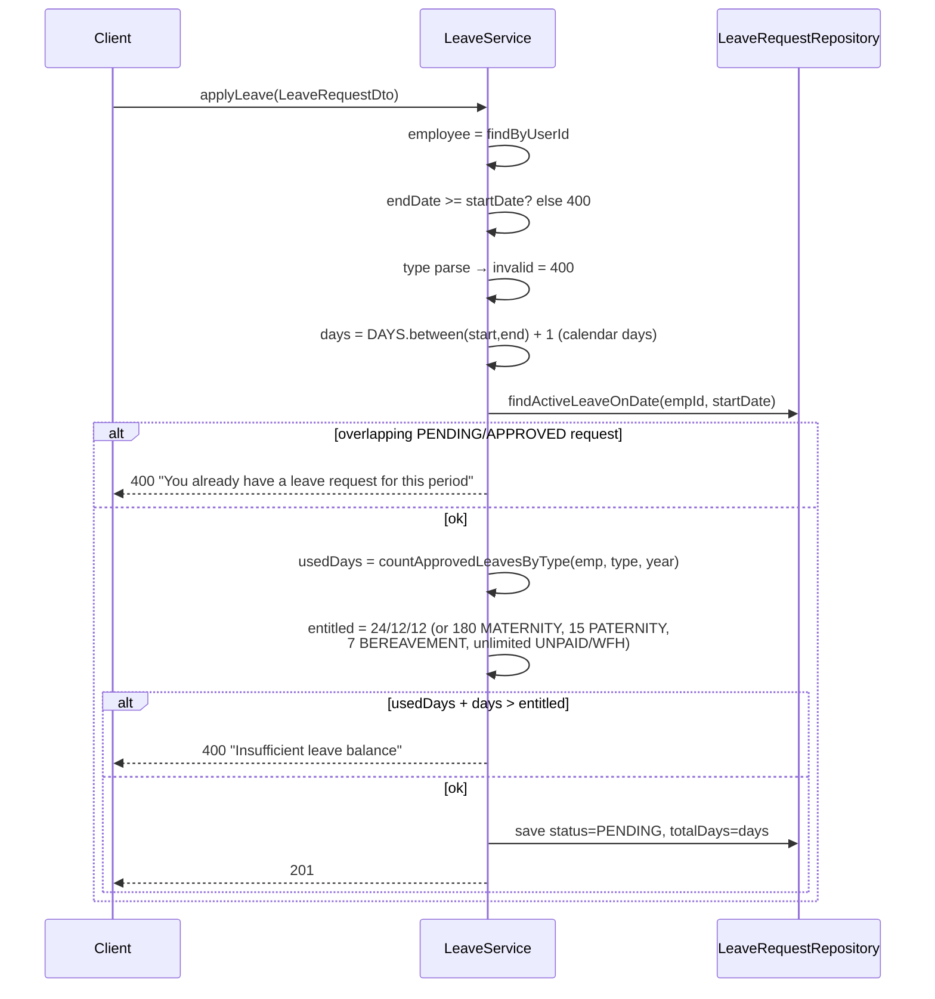

### 9.2 Approve/Reject (controller-level)

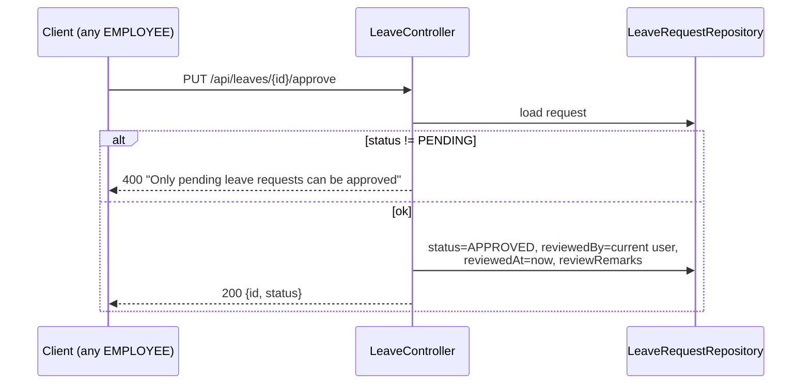

**Caveats:** no manager verification (any EMPLOYEE can approve anyone's leave), no approval email (template exists but is never called), balance "used" counts **request rows** rather than summed days.

**Cancel rules:** own request only, `PENDING` only, and only before `startDate` ("Cannot cancel leave that has already started").

---

## 10. Exit Management

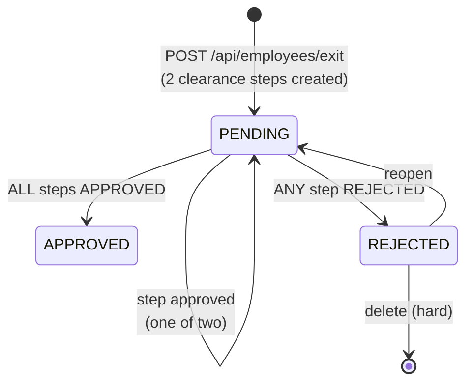

### 10.1 Endpoints

| Scope | Endpoint | Auth |
|---|---|---|
| Employee | `GET /api/employees/me/exit` | EMPLOYEE |
| Employee | `POST /api/employees/exit` | EMPLOYEE |
| Employee | `PUT /api/employees/exit/{id}/reopen` | EMPLOYEE |
| Employee | `DELETE /api/employees/exit/{id}` | EMPLOYEE |
| Employee | `POST /api/employees/exit/{id}/send-notification` | EMPLOYEE |
| Admin | `GET /api/admin/exit-requests?status=` | + `canManageEmployees` |
| Admin | `PUT /api/admin/exit-requests/{id}/steps/{stepId}/approve` | + `canManageEmployees` |
| Admin | `PUT /api/admin/exit-requests/{id}/steps/{stepId}/reject` | + `canManageEmployees` |
| Admin | `PUT /api/admin/exit-requests/{id}/reopen` | + `canManageEmployees` |
| Admin | `DELETE /api/admin/exit-requests/{id}` | + `canManageEmployees` |
| Manager | `GET /api/manager/exit-requests` | + `canManageEmployees` |
| Manager | `PUT /api/manager/exit-requests/{id}/steps/{stepId}/approve` | + `canManageEmployees` |
| Manager | `PUT /api/manager/exit-requests/{id}/steps/{stepId}/reject` | + `canManageEmployees` |
| Manager | `PUT /api/manager/exit-requests/{id}/reopen` | + `canManageEmployees` |
| Manager | `DELETE /api/manager/exit-requests/{id}` | + `canManageEmployees` |

### 10.2 Submission flow

```mermaid
sequenceDiagram
    participant C as Employee
    participant S as ExitService
    participant E as EmailService

    C->>S: submitExitRequest({place, reason, lastWorkingDate, comments})
    S->>S: employee by userId
    S->>S: existing PENDING? → 400 "You already have a pending exit request"
    S->>S: create ExitRequest status=PENDING
    S->>S: create 2 ClearanceSteps:<br/>"Manager Approval" (assignedTo=manager)<br/>"HR Clearance" (assignedTo=hr)
    S->>E: sendResignationNotificationEmail<br/>→ employee + direct reportingTo manager (async)
    S-->>C: 201
```

### 10.3 Approval rules

| Actor | Scope of list | Approve/reject guard |
|---|---|---|
| Manager (`/api/manager/...`) | direct reports **OR** same territory/squad/unit | step `assignedTo == "manager"` **AND** current user == employee's `reportingTo` |
| Admin (`/api/admin/...`) | all requests, optional status filter | any PENDING step, no ownership check |

- All steps `APPROVED` → request `APPROVED`. Any step `REJECTED` → request `REJECTED` (rejection is final until reopened).
- Reopen/delete allowed only for `REJECTED` requests.
- **No final settlement / relieving letter stage implemented.**

---

## 11. Files (Azure Blob)

| # | Endpoint | Behavior |
|---|---|---|
| 1 | `POST /api/files/upload/{submissionId}` | multipart `file`, optional `fieldName`, `folder`; dir = `folder` else `{submissionId}/{fieldName}` |
| 2 | `POST /api/files/upload` | dir = `folder` else `fieldName` else `uploads` |
| 3 | `GET /api/files/download/{submissionId}` | ZIP of all blobs under `{submissionId}/` prefix |
| 4 | `DELETE /api/files?blobUrl=` | `{"deleted": true}` |

```mermaid
sequenceDiagram
    participant C as Client
    participant CT as FileController
    participant S as FileStorageService
    participant AZ as Azure Blob (i2v-uploads)

    C->>CT: POST /api/files/upload/{submissionId}<br/>multipart file
    CT->>CT: filename = currentTimeMillis() + "_" + original
    CT->>S: upload(directory, filename, file)
    S->>S: sanitizeDirectory (allow [a-zA-Z0-9._/-])
    S->>AZ: BlobClient {dir}/{name}, overwrite=true, content-type set
    AZ-->>S: blob URL
    S-->>C: 200 {url}

    C->>CT: GET /api/files/download/{submissionId}
    CT->>S: downloadZip(submissionId)
    S->>AZ: listBlobs prefix "{submissionId}/" → download each
    S-->>C: application/octet-stream ZIP
```

- Storage config: `azure.storage.connection-string` (env; **not** in `application.properties`) and container `azure.storage.container` default `i2v-uploads`.
- No size/type validation in code → Spring Boot defaults (1 MB/file, 10 MB/request).

---

## 12. Settings & Company Settings

### 12.1 `/api/settings`

| # | Endpoint | Auth | Behavior |
|---|---|---|---|
| 1 | `GET /api/settings` | EMPLOYEE | map of all active settings |
| 2 | `GET /api/settings/{key}` | EMPLOYEE | one setting |
| 3 | `PUT /api/settings/{key}` | + `canManageAttendance` | `{value, description}` (time keys validated) |
| 4 | `POST /api/settings/clear-cache` | + `canManageAttendance` | evict `companySettings` cache |
| 5 | `GET /api/settings/my-weekly-off` | EMPLOYEE | current user's weekly off days |
| 6 | `GET /api/settings/department/{deptId}/weekly-off` | EMPLOYEE | day list |
| 7 | `GET /api/settings/department-weekly-off/all` | EMPLOYEE | all departments |
| 8 | `PUT /api/settings/department/{deptId}/weekly-off` | + `canManageAttendance` | upsert `{weeklyOffDays}` effective today |
| 9 | `GET /api/settings/is-weekly-off?date=` | EMPLOYEE | boolean |
| 10 | `GET /api/settings/late-threshold` | EMPLOYEE | `"10:00"` style string |
| 11 | `GET /api/settings/official-end-time` | EMPLOYEE | `"18:00"` style string |

### 12.2 `/api/company-settings`

| # | Endpoint | Behavior |
|---|---|---|
| 1 | `GET /api/company-settings` | {lateThreshold→10:00, officialStartTime→09:00, officialEndTime→18:00, workingHoursPerDay, defaultWeeklyOff→SATURDAY,SUNDAY} |
| 2 | `GET /api/company-settings/department/{deptId}/weekly-off` | comma-joined string |

**Weekly-off resolution precedence:**

```mermaid
flowchart TD
    A[isWeeklyOff deptId date] --> B{department_weekly_off row<br/>active AND effectiveFrom <= date<br/>AND effectiveTo null or >= date}
    B -- yes --> C[split weekly_off_days by comma<br/>match DayOfWeek name]
    B -- no --> D{DEFAULT_WEEKLY_OFF setting}
    D -- yes --> E[split default days]
    D -- no --> F[null → treat as not weekly off]
```

Settings keys: `LATE_THRESHOLD`, `OFFICIAL_START_TIME`, `OFFICIAL_END_TIME`, `WORKING_HOURS_PER_DAY`, `DEFAULT_WEEKLY_OFF` — cached (`@Cacheable companySettings`), evicted on save or via `clear-cache`.

---

## 13. Database Model (ER Diagram)

```mermaid
erDiagram
    USERS ||--o| EMPLOYEE_USERS : "1:1 (shared PK via @MapsId)"
    EMPLOYEE_USERS }o--|| DEPARTMENTS : "department_id (NOT NULL)"
    EMPLOYEE_USERS }o--|| DESIGNATIONS : "designation_id (NOT NULL)"
    EMPLOYEE_USERS }o--o| EMPLOYEE_USERS : "reporting_to (self FK)"
    EMPLOYEE_USERS }o--o| UNITS : "unit_id"
    EMPLOYEE_USERS }o--o| SQUADS : "squad_id"
    EMPLOYEE_USERS }o--o| TERRITORIES : "territory_id"
    EMPLOYEE_USERS }o--o| FOT_ACCESS_LEVELS : "fot_access_level_id"
    DEPARTMENTS }o--o| DEPARTMENTS : "parent_department_id"
    DEPARTMENTS }o--o| USERS : "manager_id"
    DEPARTMENTS }o--o| UNITS : "unit_id"
    DESIGNATIONS }o--o| DEPARTMENTS : "department_id"
    DEPARTMENTS ||--o{ DEPARTMENT_MODULE : "assign"
    MODULES ||--o{ DEPARTMENT_MODULE : "assign"
    DESIGNATIONS ||--o{ DESIGNATION_MODULE_ACCESS : "grant"
    MODULES ||--o{ DESIGNATION_MODULE_ACCESS : "grant"
    MODULES ||--o{ MODULES : "parent_module_id"
    UNITS ||--o{ SQUADS : "contains"
    SQUADS ||--o{ TERRITORIES : "contains"
    TERRITORIES ||--o{ FOT_ACCESS_LEVELS : "contains"
    EMPLOYEE_USERS ||--o{ ATTENDANCE : "unique (employee_id, attendance_date)"
    EMPLOYEE_USERS ||--o{ LEAVE_REQUESTS : "requests"
    LEAVE_REQUESTS }o--o| USERS : "reviewed_by"
    EMPLOYEE_USERS ||--o{ EXIT_REQUESTS : "submits"
    EXIT_REQUESTS ||--o{ CLEARANCE_STEPS : "has steps"
    USERS ||--o{ USER_SESSIONS : "has sessions"
    USERS ||--o{ PASSWORD_RESET_TOKEN : "has tokens"
    USERS ||--o{ NOTIFICATIONS : "receives"
    USERS ||--o{ AUDIT_LOGS : "audited"
    DEPARTMENTS ||--o{ DEPARTMENT_WEEKLY_OFF : "weekly off config"
    USERS ||--o{ USERS : "created_by / updated_by"
```

**22 tables** (Flyway `V7__i2vauthapi_schema.sql`): `users`, `employee_users`, `departments`, `designations`, `modules`, `units`, `squads`, `territories`, `fot_access_levels`, `leave_requests`, `attendance`, `exit_requests`, `clearance_steps`, `holidays`, `notifications`, `password_reset_token`, `user_sessions`, `department_module`, `designation_module_access`, `company_settings`, `department_weekly_off`, `audit_logs`.

Migration files: `V1` (baseline), `V7` (schema), `V8` (alter/fix), `V9` (repair invalid attendance times + setting defaults), `V10` (strip fractional seconds from attendance times).

---

## 14. Caching, Async & Scheduled Behavior

```mermaid
flowchart LR
    subgraph Caches
        P[userPermissions<br/>key = userId<br/>TTL 15 min + evicted on any module/access mutation]
        H[holidays<br/>key = year, TTL 15 min, evicted on holiday CRUD]
        C[companySettings<br/>key = settingKey, TTL 15 min, evicted on save / clear-cache]
    end
    subgraph Async
        E[EmailService @Async<br/>Thymeleaf → Gmail SMTP<br/>errors swallowed]
        A[AuditService @Async<br/>fire-and-forget]
    end
```

- **Caches:** Caffeine-backed Spring cache with global spec `maximumSize=1000,expireAfterWrite=15m` (`spring.cache.caffeine.spec`). Mutations still evict `allEntries` immediately; the TTL guarantees stale settings/permissions self-heal within 15 minutes across instances (e.g. `LATE_THRESHOLD` changes). Module create/update/delete also refresh `ModuleRouteConfig` (2026-09-30 fix).
- **Async:** only email + audit. Caveat: some `EmailService` methods call other methods of the same class (self-invocation bypasses the `@Async` proxy, so those run synchronously).
- **Scheduled jobs:** `@EnableScheduling` is ON but there are **zero `@Scheduled` methods**. `deleteExpiredSessions()`, `deleteExpiredTokens()`, `deleteExpiredNotifications()` are defined but never invoked — no auto-mark-absent, no cleanup.

---

## 15. Error Handling

```mermaid
flowchart TD
    X[Exception] --> H{GlobalExceptionHandler}
    H -->|ResourceNotFoundException| R404[404 ApiResponse.error msg]
    H -->|BadRequestException| R400[400 ApiResponse.error msg]
    H -->|UnauthorizedException| R401[401 ApiResponse.error msg]
    H -->|BadCredentialsException| BC[401 fixed 'Invalid email or password']
    H -->|AccessDeniedException| R403[403 fixed 'Access denied']
    H -->|MethodArgumentNotValidException| V400[400 'Validation failed'<br/>field map built but NOT returned]
    H -->|any other| R500[500 'An unexpected error occurred'<br/>details map built but NOT returned]
```

| Code | Source |
|---|---|
| 400 | validation, business rules (`BadRequestException`) |
| 401 | missing/invalid/expired JWT (entry point JSON `{status,error,message,path}`) or bad credentials |
| 403 | `@PreAuthorize`/`SecurityUtils` denial (`AccessDeniedException`) |
| 404 | `ResourceNotFoundException` |
| 429 | `RateLimitingFilter` (+ `Retry-After`) |
| 500 | uncaught exceptions (incl. raw `IllegalArgumentException` from enum `valueOf`) |

---

## 16. Email Templates

| Template | Trigger | Variables |
|---|---|---|
| `welcome.html` | signup | name, email, baseUrl, year |
| `password-reset.html` | forgot-password | name, resetLink, expiryHours=24, baseUrl, year |
| `leave-notification.html` | **never called** (method exists) | name, status, leaveType, dates, remarks, totalDays |
| `resignation-notification.html` | exit submission | employee info, place, reason, lastWorkingDate, comments |
| `resignation-notification-manager.html` | exit submission | manager name, employeeName, details |
| `attendance-alert.html` | attendance alerts (method exists) | name, alertType, message |
| `account-deactivated.html` | user deactivation | name, reason, date |
| `account-reactivated.html` | user reactivation | name, reason, date |
| `employment-status-change.html` | `updateEmployee` status change | name, oldStatus, newStatus, reason, date |
| `notification.html` | generic notification (no callers) | title, category, priority, content, actionUrl |

All sends are `@Async`, errors logged and swallowed (a failed email never fails the API call).

---

## 17. Known Limitations & Security Notes

| # | Area | Finding |
|---|---|---|
| 1 | JWT | Refresh tokens are accepted as access tokens — the filter never checks the `type` claim |
| 2 | Sessions | No per-request session validation; a valid JWT works until its 7-day expiry even after logout/revocation |
| 3 | Auth | `/api/auth/logout` has no auth requirement; `header.substring(7)` assumes `Bearer ` prefix (malformed → 500) |
| 4 | Cleanup | No scheduled jobs — expired sessions, used reset tokens, expired notifications accumulate |
| 5 | Enumeration | Forgot-password returns 404 for unknown email vs 200 for known |
| 6 | IP trust | `X-Forwarded-For` used raw for rate-limit keys, session IP, audit IP |
| 7 | Logging | `JwtAuthenticationFilter` prints URIs and first 30 chars of bearer tokens to stdout |
| 8 | Audit | `AuditService` drops `details`/`oldValue`/`newValue` parameters (no DB columns) |
| 9 | Leave authz | Any EMPLOYEE can approve/reject any leave; no manager check, no email, no audit |
| 10 | Leave balance | `countApprovedLeavesByType` counts request **rows** (COUNT), not summed `totalDays` |
| 11 | Attendance | Admin `mark`/`bulk-mark` accept any date (future, holiday, weekly off, on-leave) |
| 12 | Attendance | Check-in blocks weekly off but not holidays |
| 13 | Exit | "HR Clearance" step has no real HR resolution; no final settlement stage |
| 14 | Exit (manager) | List scope (direct report or same territory/squad/unit) is wider than action scope (direct report only) |
| 15 | Files | No size/type validation in code (Spring default 1 MB/10 MB); no user scoping; `azure.storage.*` not in `application.properties` |
| 16 | Notifications | Fully dormant — entity + repository + email method exist, nothing wired |
| 17 | Exception handler | Field-error and error-detail maps are built but never returned to clients |
| 18 | Secrets | Dev defaults for DB credentials, mail password, JWT secret present in `application.properties` |
| 19 | Hierarchy | No audit logging; department parent update has no deep cycle detection |
| 20 | Delete employee | `DELETE /api/employees/{id}` lacks the `canManageEmployees` check that create/update have |

---

## 18. Holidays

Base path: **`/api/holidays`**.

| # | Endpoint | Params | Auth | Response |
|---|---|---|---|---|
| 1 | `GET /api/holidays` | `year?` (optional int) | EMPLOYEE | `ApiResponse<List<Holiday>>` — by year if given, else all active |
| 2 | `GET /api/holidays/check` | `date` (required ISO) | EMPLOYEE | `ApiResponse<Boolean>` |
| 3 | `GET /api/holidays/info` | `date` (required ISO) | EMPLOYEE | `ApiResponse<Holiday>` |
| 4 | `POST /api/holidays` | body `Holiday` | + `canManageAttendance` | 201 `ApiResponse<Holiday>` |
| 5 | `PUT /api/holidays/{id}` | body `Holiday` | + `canManageAttendance` | `ApiResponse<Holiday>` (full save with id) |
| 6 | `DELETE /api/holidays/{id}` | — | + `canManageAttendance` | `ApiResponse<Void>` (**soft delete** → `isActive=false`) |

**Holiday fields:** `holidayName` (required, controller-validated), `holidayDate` (required, **unique** in DB), `description`, `isRecurringYearly` (default false), `isActive` (default true).

**Resolution logic** (`HolidayService`):

```mermaid
flowchart TD
    A["isHoliday / getHolidayByDate(date)"] --> B{exact active row<br/>with holidayDate = date}
    B -- yes --> C[return true / holiday]
    B -- no --> D{recurring row:<br/>isRecurringYearly = true AND<br/>same month AND same day}
    D -- yes --> C
    D -- no --> E[not a holiday]
```

- `getHolidaysByYear` is cached (`@Cacheable("holidays", key="#year")`, JPQL `YEAR(holidayDate)=year AND isActive=true`); create/update/delete evict the whole `holidays` cache (`@CacheEvict(allEntries=true)`).
- Create and update share `saveHoliday` (update passes the entity with `id` set). No uniqueness check in code — the DB unique constraint on `holiday_date` is the guard.
- Holidays are **not** blocked at check-in (only weekly off is). Their role is in summaries: `holidayDays` are subtracted from `totalWorkingDays` when computing `effectiveWorkingDays` (see Section 7.3).

---

## Appendix A — Quick Response Shapes

**Success:**
```json
{ "success": true, "message": "Success", "data": { } }
```

**Error:**
```json
{ "success": false, "message": "Error message" }
```

**Permission map entry (`/api/module-access/my-permissions`):**
```json
{
  "success": true,
  "message": "Success",
  "data": {
    "isEmployee": true,
    "userId": 5,
    "employeeCode": "EMP-001",
    "departmentId": 1,
    "departmentName": "IT",
    "designationId": 2,
    "designationTitle": "Developer",
    "role": "EMPLOYEE",
    "modules": {
      "ATTENDANCE": {
        "moduleId": 10, "moduleName": "Attendance", "moduleCode": "ATTENDANCE",
        "routePath": "/attendance", "displayOrder": 5,
        "isVisible": true, "isActive": true,
        "read": true, "create": false, "update": false, "delete": false,
        "approve": false, "export": false, "import": false,
        "accessLevel": true, "accessLevelName": "READ"
      }
    },
    "modulesByRoute": { "/attendance": { } },
    "moduleList": []
  }
}
```

## Appendix B — Changelog

### 2026-09-30 — Module access repair fix
- `GET /api/module-access/my-permissions` now includes modules with an active designation access but no `department_module` row (repair rule).
- `POST /api/module-access/designation` auto-assigns the module to the designation's department for `READ`/`WRITE`/`ADMIN`.
- Module create/update/delete evicts the `userPermissions` cache and refreshes `ModuleRouteConfig` (no restart needed).
- Attendance permission model documented (`canReadAttendance` fallback vs strict `canManageAttendance`).

### 2026-09-30 — Late-threshold drift & stale settings cache fix
- Local `company_settings.LATE_THRESHOLD` aligned with production (`10:00` → `10:30`).
- Added `spring.cache.caffeine.spec=maximumSize=1000,expireAfterWrite=15m` — settings/permission/holiday caches now self-heal, so threshold changes propagate without manual `clear-cache` or restart.

## Appendix C — DTO Inventory

**Request DTOs:**
- `SignupRequest`, `LoginRequest`, `RefreshTokenRequest`, `ForgotPasswordRequest`, `ResetPasswordRequest`
- `EmployeeUserRequest`, `EmployeeJoinDto`, `ProfileUpdateRequest`, `DepartmentRequest`
- `DesignationRequest`, `ModuleRequest`, `TerritoryRequest`, `SquadRequest`, `UnitRequest`
- `FotAccessLevelRequest`, `AttendanceRequest`, `LeaveRequestDto`, `ExitRequestDto`
- `DesignationModuleAccessRequest`

**Response DTOs:**
- `ApiResponse` — universal envelope `{success, message, data}`
- `UserResponse`, `EmployeeUserResponse`, `DepartmentResponse`, `DesignationResponse`
- `LeaveResponse`, `ExitResponseDto`, `ClearanceStepDto`
- `AttendanceResponse`, `AttendanceStatisticsResponse`, `AttendanceSummaryResponse`
- `JwtResponse` — `{accessToken, refreshToken, tokenType, userId, email, fullName, role}`
- `FotAccessLevelResponse`, `ModuleResponse`, `UnitResponse`, `SquadResponse`, `TerritoryResponse`

**Enums:**
- `UserRole`: `GENERAL, CUSTOMER, VENDOR, EMPLOYEE`
- `AccessLevel` (module permissions): `NONE, READ, WRITE, ADMIN`
- `EmploymentType`: `PERMANENT, CONTRACT, INTERN, CONSULTANT, PROBATION`
- `EmploymentStatus`: `ACTIVE, ON_LEAVE, SUSPENDED, TERMINATED, RESIGNED, INACTIVE`
- `Gender`: `MALE, FEMALE, OTHER`
- `AttendanceStatus`: `PRESENT, ABSENT, HALF_DAY, WEEKLY_OFF, HOLIDAY, LEAVE, WFH`
- `LeaveType`: `ANNUAL, SICK, CASUAL, MATERNITY, PATERNITY, BEREAVEMENT, UNPAID, WORK_FROM_HOME`
- `LeaveStatus`: `PENDING, APPROVED, REJECTED, CANCELLED`
- `ExitStatus`: `PENDING, APPROVED, REJECTED`
- `NotificationType`: `EMAIL, SMS, PUSH, IN_APP`
- `NotificationCategory`: `SYSTEM, LEAVE, ATTENDANCE, PAYROLL, ANNOUNCEMENT, ALERT`
- `NotificationPriority`: `LOW, MEDIUM, HIGH, URGENT`
